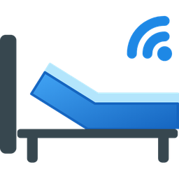

# HomeKit Adjustable Bed

Publishes a bed from [Adjustable Bed](https://github.com/kristofferR/ha-adjustable-bed) as **one
HomeKit accessory** in the Apple Home app: the bed sections, presets, massage, lights and climate
become captioned sliders and buttons in a single tile, with their own pairing code.

HomeKit Adjustable Bed is more than a companion app. It is built to run **in step with Adjustable
Bed**: same toolchain and conventions, only Adjustable Bed's published interfaces, and a sync tool
that follows every Adjustable Bed release, so it can be developed, tested and maintained alongside
it with as little effort as possible (see [In step with Adjustable Bed](#in-step-with-adjustable-bed)).

User interface languages: English and Dutch.

## Why HomeKit Adjustable Bed

Adjustable Bed's own route to Apple Home, Home Assistant's HomeKit Bridge plus scripts (see its
[HomeKit guide](https://github.com/kristofferR/ha-adjustable-bed/blob/main/docs/HOMEKIT.md)), works
well and is probably enough for most users. This integration started from two wishes that route
cannot meet: exact positions, and all controls of a bed in one tile. It was then designed so it
could serve other Adjustable Bed users too, which added the points below.

### One accessory instead of many tiles

- **Aggregated:** every control of a bed sits in one tile with its own pairing code, instead of
  one tile per entity or script (six scripts for back and legs alone, plus covers and buttons).
- **Named controls:** each slider and button shows its own caption in the tile instead of
  "Blinds 1" or "Switch 1"; names are pushed to the Home app and can be enforced.
- **Your layout:** choose the first control and the names; the form shows the resulting grid
  (the Home app sorts by itself, in rows of two).
- **Any light joins the tile:** a Hue strip under the bed or a lamp next to it, with colour and a
  per-light choice for the colour button (it replaces the caption).

### Controls the HomeKit Bridge cannot offer

- **Real positions:** the HomeKit Bridge does not support `number` entities, which carry
  Adjustable Bed's measured positions. There a cover slider is a command (above 70 % up, below
  30 % down, in between stop), so "set to 50 %" stops the bed. Here 40 % means 40 %, with live
  feedback and "opening/closing" while moving.
- **Scenes and Siri with positions:** a scene can store "reading" as back 45 %, not only start a
  movement.
- **Covers that report their position** move to the target and stop; covers without position
  get the same 70/30 zones as the HomeKit Bridge, so never worse.
- **Massage strength** (levels 0 to 10) as a slider in 10 % steps; **light and fan levels** as
  a lamp and a fan; **Sleep Number climate** (no temperature, so no thermostat) as a fan with
  Cool and Heat switches.

### Safe and predictable behaviour

- **Motion queue:** in Adjustable Bed a new command interrupts the running one; here sections
  move one after another, slider drags are debounced, and Flat, Memory and Stop clear the queue.
- **One real Stop:** a single button that also clears the queue. Via scripts a button becomes a
  switch that turns off after 10 s, and turning it off stops nothing.
- **Push buttons** reset after 1 s; real switches and lights show their real state.
- **Risky actions off by default:** saving memories, resets, connect and factory reset, because
  HomeKit asks for no confirmation. The HomeKit Bridge exposes every button unless filtered.
- **Timed buttons:** up and down per section with seconds set in the form (via
  `adjustable_bed.timed_move`), instead of a script per direction per section.
- **Inverted sliders** (flat = 100 %) so a flat bed looks off in the grouped tile.

### Set up per bed, automatically

- **Only what the bed has:** controls come from Adjustable Bed's own detection, with sensible
  defaults, for all bed types of the checked release ([Supported beds](docs/SUPPORTED_BEDS.md)).
- **No duplicates:** the cover is hidden when a real position exists, combined covers when the
  separate sections exist, per-side presets when a "both" version exists, the light button when
  a lamp exists.
- **Combined beds:** a parent bed (for example "Our bed") gets its own controls for both sides,
  with left and right light slots; each side can have its own HomeKit bed as well.
- **One form and a QR code** instead of a blueprint, six scripts per bed, HomeKit Bridge filters
  and hand-made scenes.

### Lasting in HomeKit

- **Stable identity:** adding or removing controls never renumbers the others, so the Home app
  keeps names, scenes and automations.
- **Rename without restart:** a new name reaches the Home app at once, without the bed turning
  "not responding".
- **Pairing from Home Assistant:** show the QR code again or reset the pairing, also after the
  bed was removed in the Home app while unreachable; your HomeKit Bridge pairing is untouched.

### Trade-offs

- An own HomeKit server per bed, on its own port, with its own pairing.
- Some behaviour relies on how the Home app works today (pushing names back, sort order), which
  Apple does not document ([Home app behaviour](docs/HOME_APP.md)).
- Used daily with a Jensen JMC400 (single and combined bed); other bed types are covered by
  tests only.

## In step with Adjustable Bed

Designed to follow Adjustable Bed's development, testing and maintenance with as little effort as
possible, and to be adopted into it without a migration of style or tooling:

- **Same toolchain and versions:** Python 3.14.2+, Home Assistant 2026.9.0+, `uv`, ruff
  0.15.16, pyright 1.1.411, pytest, HACS and hassfest in CI, MIT license.
- **Same conventions:** `AGENTS.md` rules, pull request template with the AI disclosure,
  changelog and one version in `manifest.json`, `pyproject.toml` and `const.py`, release notes
  with **What's New** and **Bug Fixes**.
- **Only published interfaces:** entities and their stable `translation_key`, devices and child
  devices, Home Assistant's standard actions and Adjustable Bed's public `timed_move` action. No
  imports of Adjustable Bed code, so its internals can change freely.
- **New beds work without a release:** controls are read from what Adjustable Bed creates for
  each bed; rules cover families of keys, and vendor keys without a rule are still offered.
- **Every release checked:** `tools/sync_adjustable_bed.py` reads each Adjustable Bed release
  (parsed, never executed), reports new bed types, controls and `timed_move` motors, regenerates
  names, motors, test fixture and documentation, and runs the checks. A weekly workflow opens a
  pull request with the report ([Development](docs/DEVELOPMENT.md)).
- **Tests pinned to the release:** `tests/test_adjustable_bed_sync.py` fails when the
  integration falls behind the synced release.

## Requirements

- Home Assistant **2026.9.0** or newer (Python 3.14)
- <!-- adjustable-bed-version -->[Adjustable Bed](https://github.com/kristofferR/ha-adjustable-bed) v4 with your bed set up (checked against v4.2.4, see [Supported beds](docs/SUPPORTED_BEDS.md))<!-- /adjustable-bed-version -->
- A free TCP port for the accessory (default 21070), reachable from your Apple home hub

## Installation

1. Copy `custom_components/homekit_adjustable_bed` to `config/custom_components/` (or add this
   repository to HACS as a custom integration repository) and restart Home Assistant.
2. Settings → Devices & services → Add integration → **HomeKit Adjustable Bed**.
3. Choose the Adjustable Bed device and a port, check the controls and submit.
4. Open the notification **Pair HomeKit Adjustable Bed** and scan the QR code in the Home app.
5. If you also use the HomeKit Bridge, exclude the bed's own entities there to avoid
   duplicate tiles.

## Documentation

| Guide | Contents |
|---|---|
| [Configuration](docs/CONFIGURATION.md) | The setup and options forms, naming, display, layout, pairing |
| [Detection](docs/DETECTION.md) | How bed entities map to HomeKit controls, defaults per group |
| [Supported beds](docs/SUPPORTED_BEDS.md) | All bed types of the checked Adjustable Bed release |
| [Home app behaviour](docs/HOME_APP.md) | Captions, order, colour button, open/closed, renames |
| [Architecture](docs/ARCHITECTURE.md) | Why an own HAP accessory, modules, data model |
| [Development](docs/DEVELOPMENT.md) | Environment, tests, translations, CI, releases |
| [Changelog](CHANGELOG.md) | Version history |

## Status

Developed and used with a Jensen JMC400 (single beds and a combined bed). Other bed types are
covered by tests per bed family and against every entity of the synced Adjustable Bed release;
reports from owners of other beds are welcome.
